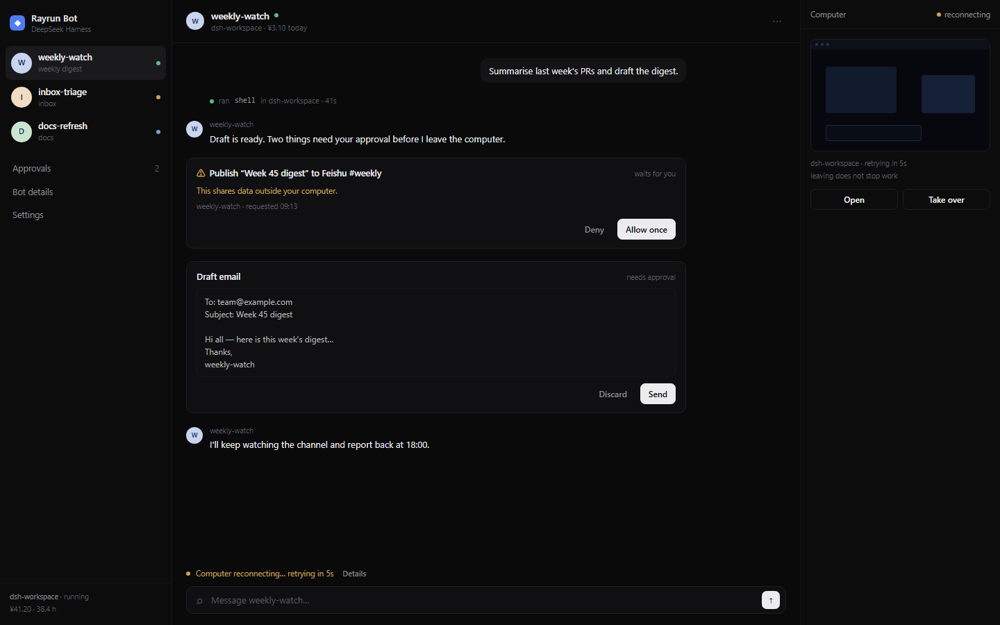
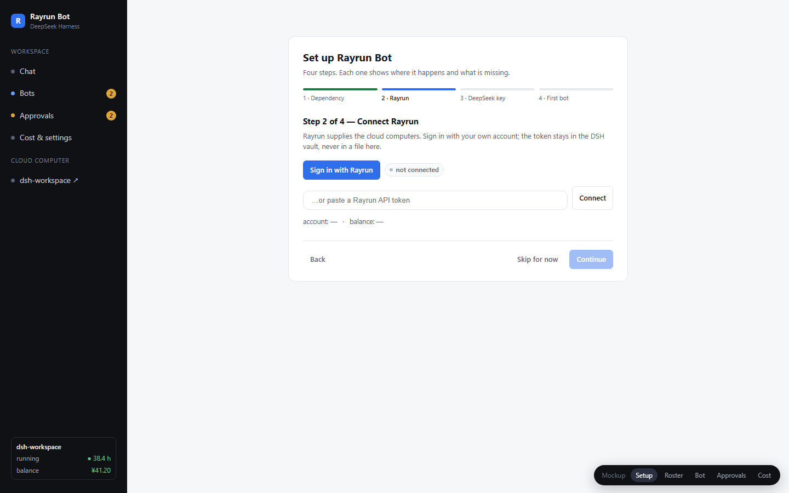
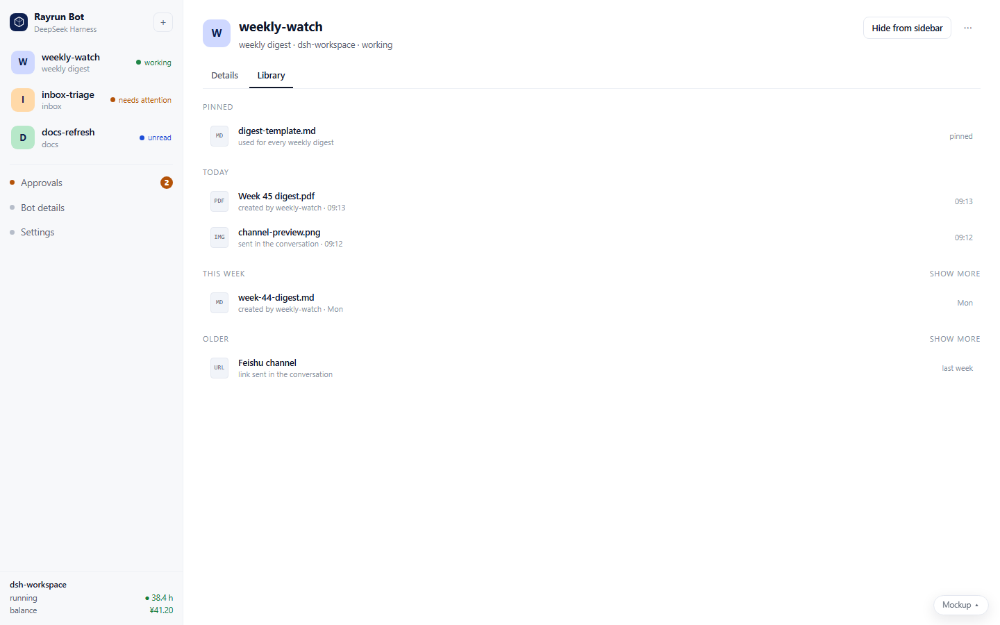

<div align="center">


# Rayrun Bot

**Bots with a name, a body and a home.**

Rayrun Bot is the bot layer for [DeepSeek Harness](https://github.com/deepseek-ai/deepseek-harness).
It gives each bot a name, a job brief, memory and a schedule — and a place to live:
your own [Rayrun](https://rayrunos.com/) cloud computer, a Linux machine you can watch
and take over. Bots are designed to think with your own DeepSeek key.

No project-run account, relay or control plane. The compute runs on your Rayrun
account, the model bill is yours, and the approval prompt is the contract.

English | [简体中文](README.zh-CN.md)

<sub>DeepSeek Harness &nbsp;·&nbsp; Rayrun cloud computer &nbsp;·&nbsp; Local-first approvals &nbsp;·&nbsp; MIT</sub>

</div>

<p align="center">
  
</p>
<p align="center"><sub>Design preview. What is wired up today is tracked separately in <a href="docs/12-status.md">docs/12-status.md</a>.</sub></p>

> Rayrun Bot is pre-alpha. The product story lives here; the source of record for
> what works, what is missing and which combinations were verified live is
> [docs/12-status.md](docs/12-status.md).

## A bot is not a chat

A chat session ends when the tab closes. A bot keeps its name, its job brief, its
memory and its workspace. You assign work, close the laptop, and come back to a
colleague that reports what it did, what it needs, and what it deliberately did
not do.

Rayrun Bot is built for that handoff, not for another chat window.

## What you get

<table>
<tr>
<td width="50%" valign="top">

### A colleague, not a session

Bots have a name, a personality, standing instructions and a persistent thread.
The roster is the product surface: pick a bot the way you pick a contact, not the
way you open a new tab.

</td>
<td width="50%" valign="top">

### A computer with hands

Each person gets a Linux cloud computer shared by their bots: a real `workspace`,
a browser profile, an X11 desktop, and the ability to run commands, move files
and drive a browser. You can watch the screen and take over at any time.

</td>
</tr>
<tr>
<td width="50%" valign="top">

### Your key, your bill

Your DeepSeek key is stored as a Rayrun credential and injected into the agent
process inside your machine. Model calls come from your account, not ours. The
key does not go into the workspace or the chat.

</td>
<td width="50%" valign="top">

### Approvals before the outside world

Work inside the computer can proceed. Actions with an outside effect stop at an
approval card, in the conversation where the action stopped. Unknown, expired or
unanswered means no. Fail-closed is the default, not a setting.

</td>
</tr>
<tr>
<td width="50%" valign="top">

### Work that survives the tab

Sessions, queues and transcripts live on your side and on the machine. Close the
page, restart the local host, or let the cloud host keep working while your
laptop is shut. The conversation picks up where it stopped.

</td>
<td width="50%" valign="top">

### Routines that come back with a report

A bot can run a prompt on a schedule — an inbox sweep, a channel watch, a weekly
digest — and put the result back into the same persistent history. Scheduled
work is designed to continue when the local page is not open.

</td>
</tr>
</table>

## The surface

The Bots page is designed as three columns inside DSH: the roster on the left, a
markdown conversation in the middle, and the current bot's details on the right.
Setup is four steps: the dependency, Rayrun, the computer and the first bot.
Approval requests appear inline, where they are needed.

<table>
<tr>
<td width="50%" valign="top">



<sub><b>Setup.</b> Dependency, Rayrun, computer, first bot — each step says what is missing and where to fix it.</sub>

</td>
<td width="50%" valign="top">



<sub><b>Library.</b> What the bot produced, grouped by day, next to the conversation that produced it.</sub>

</td>
</tr>
</table>

The visual design and clickable mockups are in
[docs/design/ui-design.md](docs/design/ui-design.md) and
[docs/mockups/index.html](docs/mockups/index.html).

## How it fits together

```
you ── chat / approve ──▶ DSH (your desk)                browser tab or desktop app
                           │  bot layer: tools · same-origin RPC · approvals
                           ▼
                      Rayrun API · https://api.rayrunos.com/v1
                           ▼
       your Rayrun cloud computer   (one per person, shared by your bots)
         ├─ DSH host on the machine: one session per bot
         ├─ /workspace · browser profile · X11 desktop
         └─ model calls ──▶ DeepSeek API (your key, injected per process)
```

The desk is where you come back to. The body is where the work happens. The brain
is the key you already pay for. Memory is the bot's own state on the machine.
Only one of those needs to be online while the bot works.

## Design choices

- **One computer per person, not per bot.** It is cheaper and simpler, and bots
  share files, browser sessions and credentials the way a person's tools do. The
  tradeoff: a bot is not a security boundary — do not use two bots as sandboxes
  against each other.
- **Bring your own accounts.** No control plane of ours holds your keys or meters
  your usage. Rayrun is your infrastructure vendor, DeepSeek is your model vendor,
  and this repository is the glue.
- **Local-first where it protects you.** Your workspace, profile and credentials
  stay on your side. Execution can leave the machine; decisions and secrets do
  not.
- **Approvals are fail-closed.** A bot may work freely inside its own computer,
  but anything with an outside effect waits for you. A timeout is a no.
- **Boring on purpose.** Plain ESM, no runtime dependencies, no build step. The
  DSH on your desk is the same DSH that runs in the cloud.
- **Two plugins, one product.** Rayrun Bot consumes the independent
  [dsh-rayrun-computer](https://github.com/RayrunOS/dsh-rayrun-computer) project
  through its published tools and version contract. We do not fork or vendor it.

## What it is not

Rayrun Bot is not a hosted SaaS, a bot marketplace or a multi-tenant platform.
There is no project-run account, relay or control plane. It is not a replacement
for DSH, and it does not make the cloud agent a security boundary it is not
[designed to be](docs/07-security.md).

## Who it is for

Rayrun Bot is for people who want a personal AI colleague that does real work on a
real computer they control — clearing an inbox, watching a channel, pulling a
report from a legacy portal — without handing their accounts to a hosted service.

## Start here

| | |
| --- | --- |
| [Status](docs/12-status.md) | What works today, what is missing, and the verified combinations. |
| [Running what exists today](docs/09-deployment.md) | Install the two plugins, configure Rayrun, create the first bot. |
| [Product direction](docs/00-product-direction.md) | Who it is for, the v0.1 scope and the product decisions. |
| [System architecture](docs/01-system-architecture.md) | Layers, boundaries and the trust model. |
| [Approvals](docs/05-approvals.md) | What needs a yes, who executes it locally, and what still waits for the platform. |
| [Security](docs/07-security.md) | What is protected, what is not, and how to report a vulnerability. |
| [FAQ](docs/faq.md) | Pricing, credentials, models, self-hosting and the honest limits. |
| [Contributing](CONTRIBUTING.md) | How to propose a change and the local checks. |
| [Documentation index](docs/README.md) | The full doc map and the ADR register. |

## Acknowledgements

- [Rayrun](https://rayrunos.com/) for the cloud computers and the separate
  [dsh-rayrun-computer](https://github.com/RayrunOS/dsh-rayrun-computer) plugin
  this project builds on.
- [DeepSeek Harness](https://github.com/deepseek-ai/deepseek-harness) for the agent
  runtime this plugs into.
- Grok Bot, dsh-superagent and OpenMausBot, which showed what this shape should be
  — and where it breaks.

## License

MIT. Your Rayrun account, your cloud computer and your DeepSeek key stay yours;
the license covers the code in this repository.
