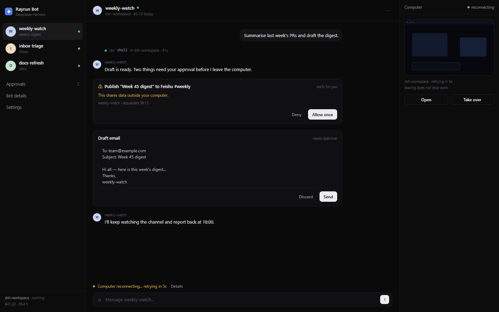
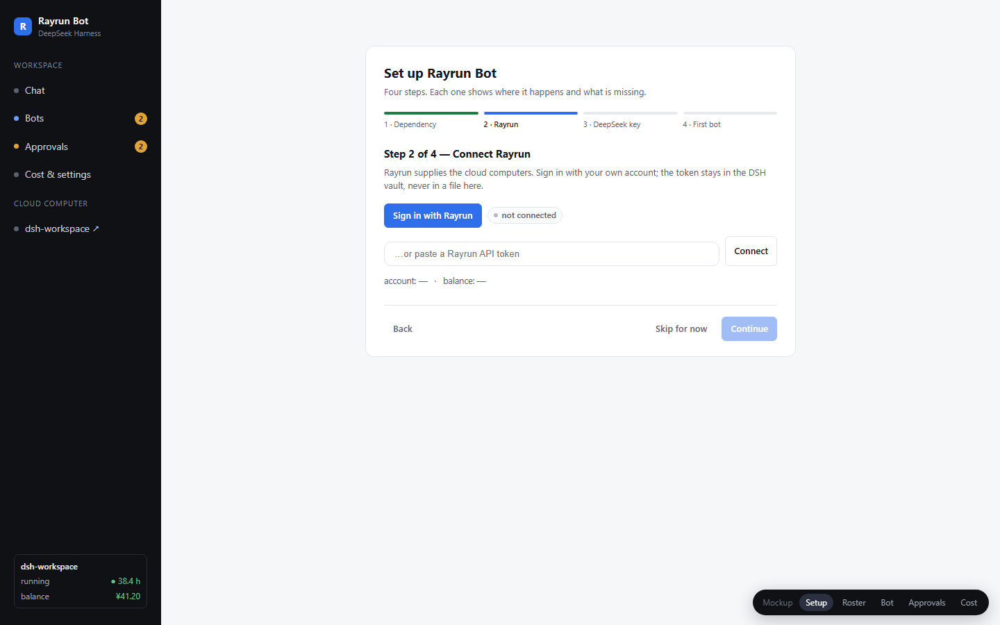
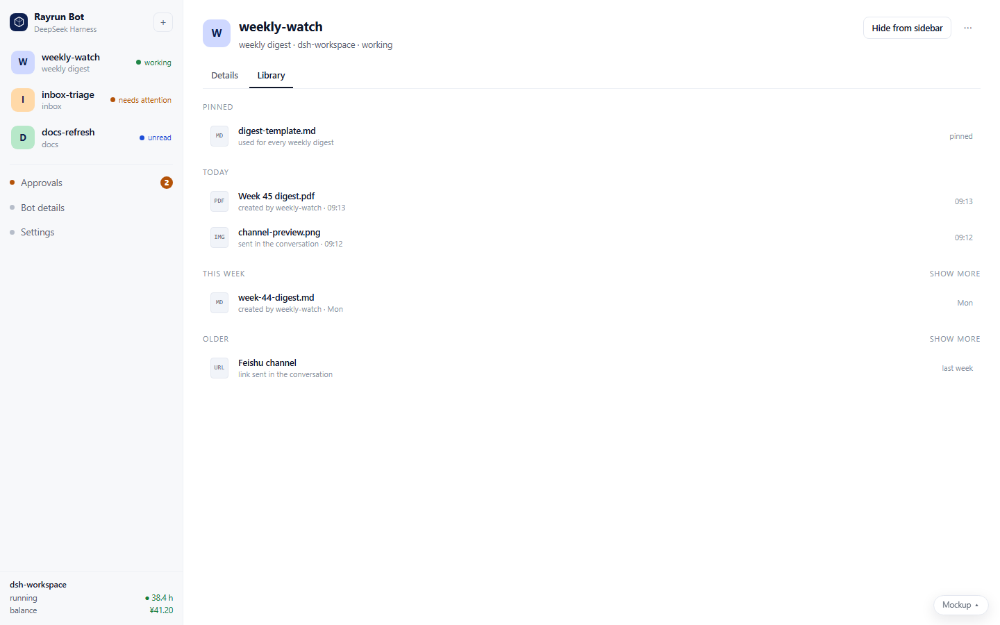

<div align="center">


# Rayrun Bot

**给 Bot 一个名字、一副身体和一个家。**

Rayrun Bot 是 [DeepSeek Harness](https://github.com/deepseek-ai/deepseek-harness) 的
bot 层。它给每个 bot 一个名字、一份职责说明、一段记忆和一个日程——还有一个住的地方：
你自己的 [Rayrun](https://rayrunos.com/) 云电脑，一台你能看见、也能接管的 Linux
机器。Bot 被设计为用你自己的 DeepSeek key 思考。

没有项目方账号、中继或控制面。算力跑在你的 Rayrun 账号上，模型账单是你的，
审批提示就是约定。

[English](README.md) | 简体中文

<sub>DeepSeek Harness &nbsp;·&nbsp; Rayrun 云电脑 &nbsp;·&nbsp; 本地优先审批 &nbsp;·&nbsp; MIT</sub>

</div>

<p align="center">
  
</p>
<p align="center"><sub>设计预览。今天实际接通了什么，以 <a href="docs/12-status.md">docs/12-status.md</a> 为准。</sub></p>

> Rayrun Bot 处于 pre-alpha。产品叙事写在这里；今天能做什么、还不能做什么，以及
> 实际验证过的组合，以 [docs/12-status.md](docs/12-status.md) 为准。

## Bot 不是聊天

标签页一关，聊天会话就结束了。Bot 会留下它的名字、职责说明、记忆和工作区。你派活、
合上笔记本，回来时面对的是一位同事：它汇报做了什么、需要什么，以及哪些事情它刻意
没有做。

Rayrun Bot 为这种交接而设计，不是又一个聊天窗口。

## 你会得到什么

<table>
<tr>
<td width="50%" valign="top">

### 一位同事，不是一个会话

Bot 有名字、性格、长期指令和持续的对话线程。名册就是产品表面：像选联系人一样选
一个 bot，而不是像开新标签页那样开一个新会话。

</td>
<td width="50%" valign="top">

### 一台能动手的电脑

每人一台 Linux 云电脑，由这个人的所有 bot 共享：真实的 `workspace`、浏览器
profile、X11 桌面，并且能跑命令、搬文件、开浏览器。你可以看着屏幕工作，也可以随时
接管。

</td>
</tr>
<tr>
<td width="50%" valign="top">

### 你的 key，你的账单

你的 DeepSeek key 存为 Rayrun credential，被注入机器里的 agent 进程。模型调用从
你的账号发出，不是我们的。key 不进入工作区，也不进入聊天消息。

</td>
<td width="50%" valign="top">

### 外部动作先停在审批

电脑内部的工作可以继续。有外部副作用的动作会停在审批卡上，卡片出现在动作停下的
对话里。未知、超时、无人回答都算「不」。Fail-closed 是默认，不是设置项。

</td>
</tr>
<tr>
<td width="50%" valign="top">

### 关掉标签页，工作还在

会话、队列和 transcript 留在你这一侧和机器上。关掉页面、重启本地 host，或者让云
host 在你的笔记本合上后继续工作。对话从停下的地方接着走。

</td>
<td width="50%" valign="top">

### 跑完会回来汇报的 routine

Bot 可以按日程跑一个 prompt——清理收件箱、盯一个频道、做一份周报——再把结果放回
同一段持续 history。日程工作被设计为在本地页面没打开时也能继续。

</td>
</tr>
</table>

## 产品表面

Bots 页面被设计为 DSH 里的三栏：左边是名册，中间是 markdown 对话，右边是当前 bot
的详情。设置流程是四步：依赖、Rayrun、云电脑和第一个 bot。审批请求出现在需要它的
地方，而不是另一个收件箱。

<table>
<tr>
<td width="50%" valign="top">



<sub><b>设置。</b> 依赖、Rayrun、云电脑、第一个 bot——每一步都说清还缺什么、去哪里补。</sub>

</td>
<td width="50%" valign="top">



<sub><b>Library。</b> Bot 产出的东西按日期分组，和产生它的对话放在一起。</sub>

</td>
</tr>
</table>

视觉设计与可点击 mockup 见 [docs/design/ui-design.md](docs/design/ui-design.md) 和
[docs/mockups/index.html](docs/mockups/index.html)。

## 它怎么组合起来

```
你 ── 聊天 / 审批 ──▶ DSH（你的桌面）                   浏览器标签页或桌面 App
                       │  bot 层：工具 · 同源 RPC · 审批
                       ▼
                  Rayrun API · https://api.rayrunos.com/v1
                       ▼
     你的 Rayrun 云电脑   （每人一台，由你的多个 Bot 共享）
       ├─ 机器上的 DSH host：每个 Bot 一个 session
       ├─ /workspace · 浏览器 profile · X11 桌面
       └─ 模型调用 ──▶ DeepSeek API（你的 key，按进程注入）
```

桌面是你回来的地方。身体是工作发生的地方。大脑是你已经在付费的 key。记忆是 bot
自己在机器上的状态。Bot 工作时，只有其中一部分需要一直在线。

## 设计取舍

- **每人一台电脑，不是每个 bot 一台。** 更便宜也更简单，bot 像一个人的工具那样共享
  文件、浏览器会话和凭据。代价是：bot 不是安全边界——不要把两个 bot 当成彼此的沙箱。
- **自带账号。** 我们没有控制面持有你的 key，也不计量你的用量。Rayrun 是你的基础
  设施供应商，DeepSeek 是你的模型供应商，本仓库是胶水。
- **在保护你的地方 local-first。** 工作区、profile 和凭据留在你这一侧；执行可以离开
  机器，决策和密钥不行。
- **审批 fail-closed。** Bot 可以在自己的电脑里自由工作，但任何有外部副作用的动作都
  要等你。超时就是拒绝。
- **刻意无聊。** 纯 ESM，无运行时依赖，无构建步骤；你桌面上的 DSH 和云上的 DSH 是
  同一个 DSH。
- **两个插件，一个产品。** Rayrun Bot 通过已发布的 tools 和版本契约消费独立的
  [dsh-rayrun-computer](https://github.com/RayrunOS/dsh-rayrun-computer) 项目。
  我们不 fork，也不 vendor 它。

## 它不是什么

Rayrun Bot 不是托管 SaaS、bot 市场或多租户平台。没有项目方账号、中继或控制面。
它不是 DSH 的替代品，也不会把云端 agent 变成它
[不应被当成](docs/07-security.md)的安全边界。

## 适合谁

Rayrun Bot 适合这样的人：想要一位真正干活的个人 AI 同事，在由自己控制的真实电脑上
工作——清理收件箱、盯一个频道、从老系统里拉一份报表——而不必把账号交给托管服务。

## 接着读

| | |
| --- | --- |
| [状态](docs/12-status.md) | 今天能做什么、还缺什么，以及验证过的组合。 |
| [运行今天的版本](docs/09-deployment.md) | 安装两个插件、配置 Rayrun、创建第一个 bot。 |
| [产品方向](docs/00-product-direction.md) | 面向谁、v0.1 范围和产品决策。 |
| [系统架构](docs/01-system-architecture.md) | 分层、边界和信任模型。 |
| [审批](docs/05-approvals.md) | 什么需要同意、谁在本地执行、什么还在等平台。 |
| [安全](docs/07-security.md) | 什么受保护、什么不受保护，以及如何报告漏洞。 |
| [FAQ](docs/faq.md) | 定价、凭据、模型、自托管和诚实的限制。 |
| [贡献](CONTRIBUTING.md) | 如何提改动，以及本地检查。 |
| [文档索引](docs/README.md) | 完整文档地图和 ADR 登记册。 |

## 致谢

- [Rayrun](https://rayrunos.com/) 提供云电脑，以及本项目构建其上的独立
  [dsh-rayrun-computer](https://github.com/RayrunOS/dsh-rayrun-computer) 插件。
- [DeepSeek Harness](https://github.com/deepseek-ai/deepseek-harness) 提供本插件
  接入的 agent runtime。
- Grok Bot、dsh-superagent 和 OpenMausBot：它们展示了这个形状应该是什么样，
  以及它会在哪里坏掉。

## 许可证

MIT。你的 Rayrun 账号、你的云电脑和你的 DeepSeek key 始终属于你；许可证覆盖本仓库
的代码。
