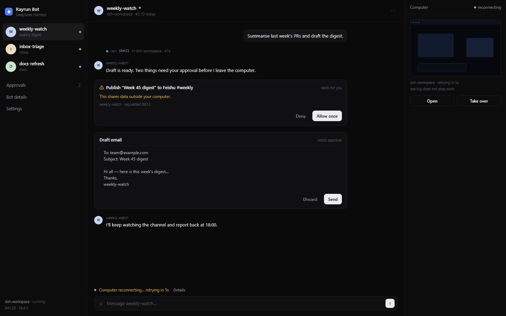

# dsh-rayrun-bots

The Rayrun Bot plugin for [DeepSeek Harness](https://github.com/deepseek-ai/deepseek-harness).
The product page is the repository README:
[English](https://github.com/RayrunOS/Rayrun-Bot/blob/main/README.md) ·
[简体中文](https://github.com/RayrunOS/Rayrun-Bot/blob/main/README.zh-CN.md).
This file is the same install and the same limits, for the npm package.

**Bots with a name, a body, and a home.** Each bot has a name, a job brief,
memory, and a schedule, and it lives on your own [Rayrun](https://rayrunos.com/)
cloud computer: a Linux machine you can watch and take over. It thinks with your
DeepSeek key. The computer is billed to your Rayrun account, and the model bill
is yours. There is no project-run account, relay, or control plane. You install
this package into DeepSeek Harness.

> **Pre-alpha.** v0.1 is not delivered, the three-minute first-run path has not
> been timed end to end, and this is not a production bot layer or a product for
> a general audience. What works, what is missing, and which combinations were
> actually checked is [docs/12-status.md](https://github.com/RayrunOS/Rayrun-Bot/blob/main/docs/12-status.md).
> If this file and that doc disagree, the status doc wins. Summary below is as
> of 2026-11-25.

<p align="center">
  
</p>
<p align="center"><sub>Design preview, not a screenshot of today's build.</sub></p>

## Who it is for

People who already run DeepSeek Harness and want a named bot on a Rayrun computer
they pay for, using their own DeepSeek key, with an approval stop on starting,
stopping, pausing, and resuming that computer.

It is for someone who can read the status doc and tolerate gaps. It is not a
hosted assistant, a bot marketplace, or a multi-tenant platform.

## Install

You need [DeepSeek Harness](https://github.com/deepseek-ai/deepseek-harness) first.
This package declares `engines.dsh` `>=0.2.0-rc.2 <0.3.0`. The command below was
checked with DSH `0.2.2-rc.5`. Checked combinations are in the
[version matrix](https://github.com/RayrunOS/Rayrun-Bot/blob/main/docs/version-matrix.md).

Install both plugins from the official npm registry, in one command, with the
versions pinned. Do not install this package by itself.

```bash
npm_config_registry=https://registry.npmjs.org \
  dsh plugin --profile web add \
  dsh-rayrun-computer@1.2.1 dsh-rayrun-bots@0.1.1-alpha.1
```

Restart DSH after that. The Bots page loads when the page starts.

Then, in Bots:

1. Connect Rayrun. The token stays in the Harness vault on the host. The page does not receive it.
2. Adopt a computer you already have, or create one. Creating a computer is billed by Rayrun. The page can stop a machine. Only a confirmed computer update destroys the old computer, after the replacement is ready.
3. If the computer does not already have a DeepSeek credential, the setup step can store your key as a Rayrun credential. The key is injected into the agent process. It does not go into the workspace or the chat.
4. Create a bot and send a message. The sample bots shown before you create one are an in-memory preview. They do not run on a computer.

`dsh-rayrun-bots@0.1.1-alpha.1` is the npm `alpha` dist-tag. `latest` is still
`0.1.0-alpha.0`. There is no stable release. An untagged
`npm install dsh-rayrun-bots`, or `dsh plugin add` without these versions, does
not select `0.1.1-alpha.1`. Installing the bots package alone does not turn on
the computer plugin: both packages have to be in the same `dsh plugin add`.
Pin `dsh-rayrun-computer` at `1.2.1`. The `1.2.0` package on npm is an older
build. A mirror can lag behind the official registry, which is why the command
sets the registry.

On 2026-11-25 that command was checked against the official registry: both
plugins loaded, and one turn sent to an existing stopped hosted machine came
back. That check used the preview on-machine host (off unless you enable it)
and a maintainer machine. The machine from that check is not a setup
requirement, and the check is not a promise for every account or image.

The on-machine host stays off until you enable `cloudHost`. The switch, and the
longer operator notes, are in
[docs/09-deployment.md](https://github.com/RayrunOS/Rayrun-Bot/blob/main/docs/09-deployment.md).

## What you can do today

Still pre-alpha. This is the short version; evidence is in
[docs/12-status.md](https://github.com/RayrunOS/Rayrun-Bot/blob/main/docs/12-status.md).

- Load both plugins and open a Bots page: roster, conversation, details, new bot, setup, and settings, in Chinese and English.
- Keep bots you create: name, instructions, session, and transcript survive a page reload.
- Send a turn to a Rayrun computer you already have. A stopped or paused machine may be started for that turn, which spends machine time. Closing the page does not have to drop the turn.
- Open the computer's desktop, and stop the machine. Stop does not destroy it; only a confirmed computer update removes the old computer, after the replacement is ready.
- Approve or deny start, stop, pause, and resume. Allow once runs that action from your local host. Deny, expiry, or an unknown result does not run it.
- Create, pause, and remove an interval routine. A routine is an ordinary turn. Turning one on can wake a machine and spend money on later runs. Cron and event triggers are not built.
- Optionally run a preview host on the computer, one process shared by your bots. With it on, a routine can run while local DSH is stopped. It is off by default. The hosted check used a machine image new enough for Rayrun runtimes (`dsh-bot@1`). Older official images can reject the runtime with `guestd_outdated`.

## What it does not do

- It does not deliver v0.1, and the three-minute first-run path has not been timed end to end. A clean-install browser turn and the start/stop/pause/resume approval cards have been checked on a maintainer machine; that is not a promise for every account.
- It does not publish a stable release. `latest` remains the older alpha.
- It does not host the bot for you, meter you, or hold your accounts. There is no project relay in the middle.
- It does not approve actions other than machine start, stop, pause, and resume. Credential actions on the computer are not covered. The agent on the machine is not an approval sandbox, and a bot is not a security boundary: your bots share one computer.
- It does not offer IM channels, a per-bot spend report, or cron and event triggers.

## How the pieces fit

```
you ── chat / approve ──▶ DSH (your desk)
                           │  bot layer
                           ▼
                      Rayrun API
                           ▼
       your Rayrun cloud computer   (one per person, shared by your bots)
         ├─ workspace, browser, desktop
         └─ model calls ──▶ DeepSeek (your key, injected into the agent process)
```

You pay Rayrun for the computer and DeepSeek for the model. This project does
not sit on either bill. The license for the code is MIT.

One computer per person is the design: cheaper, and the bots share files the way
one person's tools do. A bot may work inside that computer; the machine actions
that are built stop for approval, and a timeout is a no.

## Read next

| | |
| --- | --- |
| [Status](https://github.com/RayrunOS/Rayrun-Bot/blob/main/docs/12-status.md) | What works, what is missing, and the checked combinations. This page defers to it. |
| [Install and run](https://github.com/RayrunOS/Rayrun-Bot/blob/main/docs/09-deployment.md) | Operator notes, including how to turn on the preview host. |
| [Version matrix](https://github.com/RayrunOS/Rayrun-Bot/blob/main/docs/version-matrix.md) | Combinations that were actually checked. |
| [Security](https://github.com/RayrunOS/Rayrun-Bot/blob/main/docs/07-security.md) | What is protected, and what is not. |
| [FAQ](https://github.com/RayrunOS/Rayrun-Bot/blob/main/docs/faq.md) | Pricing, credentials, models, and limits. |
| [Repository README](https://github.com/RayrunOS/Rayrun-Bot/blob/main/README.md) | The same page, plus the Chinese mirror. |

MIT © RayrunOS.
